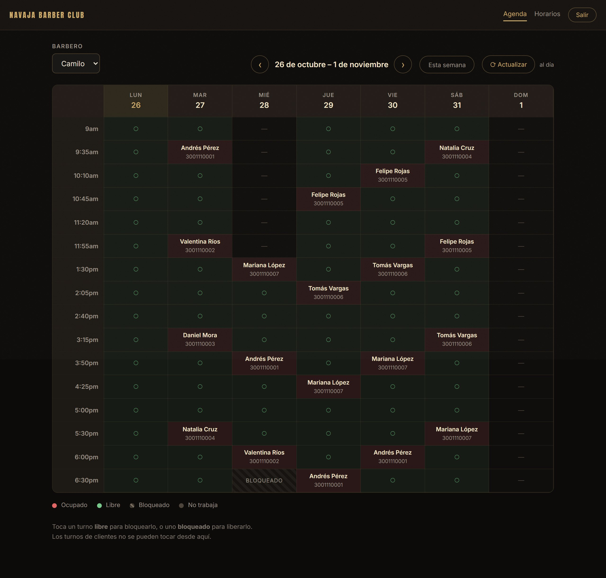
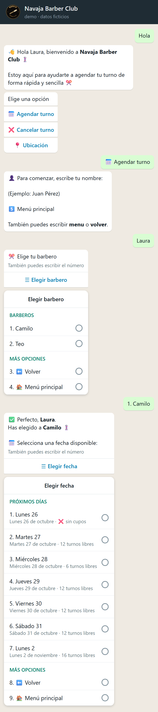
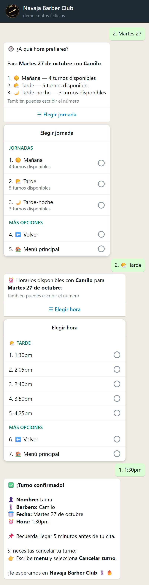
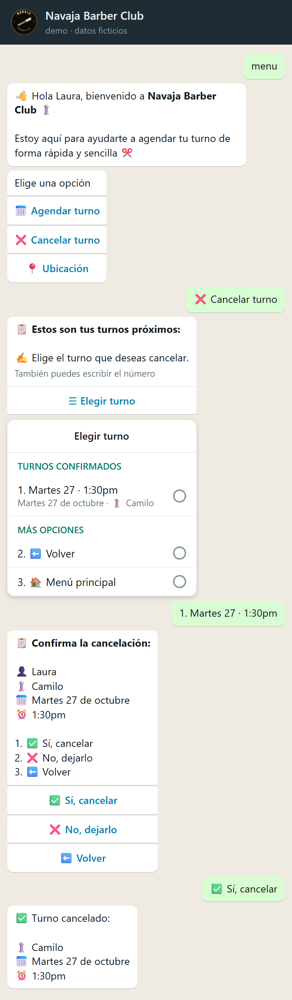
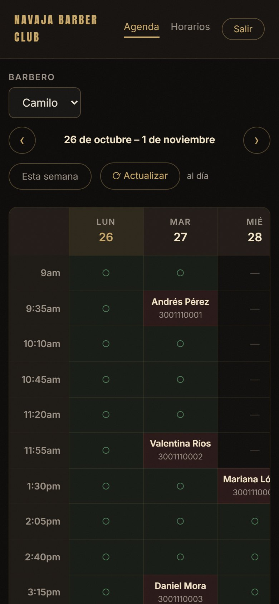
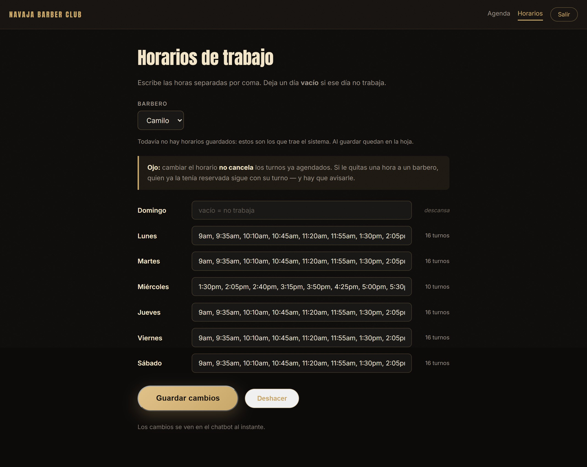
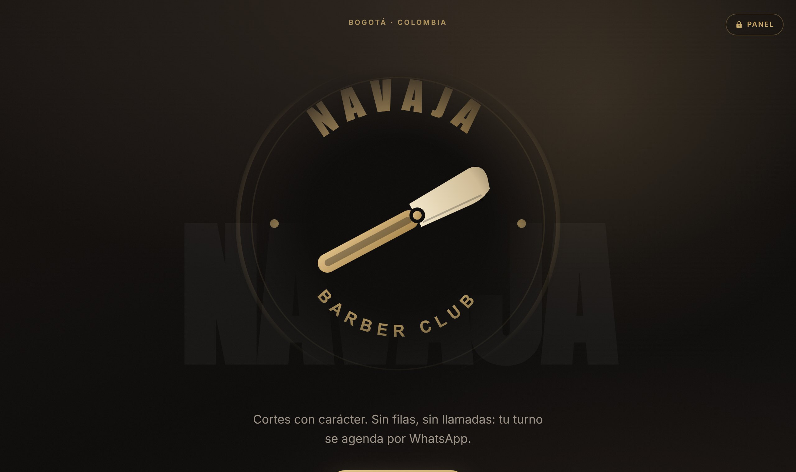
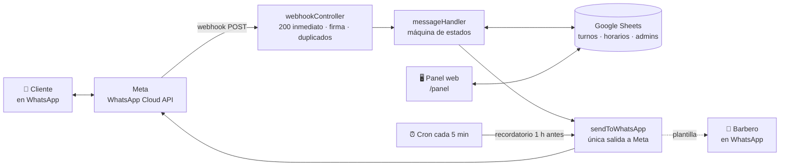

# 💈 Chatbot de agendamiento por WhatsApp para una barbería

Los clientes agendan y cancelan su turno solos, por WhatsApp, sin llamar ni esperar a que alguien conteste. Los barberos consultan su agenda desde el mismo chat, y el dueño administra la semana desde un panel web.




> **Mi primer chatbot.** Está en producción desde abril de 2026 atendiendo a una barbería real de Colombia.
> Este repositorio es una copia para portafolio: **el nombre de la barbería, los barberos, los clientes y los teléfonos son ficticios**, y el historial de git empieza de cero.
> La segunda versión, rehecha con lo aprendido aquí, es [**chatbot-barberias-whatsapp**](https://github.com/diaz021/chatbot-barberias-whatsapp).

---

## El problema

Agendar a mano por mensajes de WhatsApp depende de que alguien esté pendiente del celular. Los turnos se cruzan o se olvidan, y quien escribe fuera del horario no tiene respuesta hasta el día siguiente.

## La solución

Un bot que atiende solo, a cualquier hora:

- **El cliente** toca botones y listas nativas de WhatsApp: elige barbero, día y hora, y recibe la confirmación al instante. Puede cancelar por el mismo chat. Una hora antes le llega un recordatorio.
- **El barbero** recibe un aviso cada vez que le agendan un turno, y consulta su agenda escribiéndole al bot su contraseña.
- **El administrador** entra a un panel web con un código que le llega por WhatsApp: ve la semana de cada barbero, bloquea horarios con un toque y edita las jornadas.

Todo se guarda en **una hoja de Google Sheets**, que el dueño puede mirar y corregir sin saber nada de programación.

---

## Capturas

Todas salen del **código real** corriendo con datos ficticios ([cómo se generan](#cómo-se-generaron-las-capturas)).

<table>
<tr>
<td width="33%"></td>
<td width="33%"></td>
<td width="33%"></td>
</tr>
<tr>
<td><b>1 · Empezar.</b> Menú con botones, y listas para el barbero y la fecha. Cada día dice cuántos turnos le quedan.</td>
<td><b>2 · Agendar.</b> Si el día no cabe en una lista, el bot pregunta primero la jornada. Luego la hora y la confirmación.</td>
<td><b>3 · Cancelar.</b> El cliente ve solo sus turnos futuros y confirma antes de cancelar.</td>
</tr>
</table>

| Panel en el celular | Editar las jornadas |
|---|---|
|  |  |

Y la web pública de la barbería, desde donde se llega al panel:



---

## Arquitectura

Un solo proceso de Node atiende tres cosas en la misma URL: el webhook del bot, la web pública y el panel.



## Decisiones técnicas destacadas

**1. Responder a Meta antes de procesar.** Si el webhook tarda en contestar, Meta da la entrega por fallida y reenvía el mismo mensaje, y el cliente recibe respuestas que nunca pidió. Por eso el `200` sale primero y el mensaje se procesa después. Encima hay dos defensas más: se ignora un `message.id` ya visto, y se descartan los mensajes de **más de 15 minutos** — que es lo que suelta Meta de golpe cuando el webhook estuvo caído.

**2. Un fallo de Google nunca se disfraza de "no hay cupos".** Si la hoja no responde, la lectura lanza un error propio (`SheetsUnavailableError`) en vez de devolver una lista vacía. Sin eso, un fallo de red se veía igual que una agenda llena y el cliente se iba creyendo que no había turnos. Ahora el bot le dice la verdad: *"No puedo consultar la agenda en este momento"*.

**3. Caché para leer, lectura fresca para escribir.** La hoja se cachea 20 segundos y los horarios 5 minutos, para no agotar la cuota de la API de Google. Pero las validaciones finales —si el horario sigue libre y si el cliente ya tiene dos turnos ese día— **siempre leen sin caché**: entre que el cliente ve la lista y toca la hora, otro pudo tomarla.

**4. Releer la fila antes de escribir.** Cancelar un turno o liberar un bloqueo guarda el número de fila, pero antes de escribir se relee y se compara teléfono, fecha, hora y barbero. Si alguien insertó filas a mano en la hoja, el número apunta a otro turno; sin esta verificación se le cancelaba la cita a un cliente que no había pedido nada.

**5. El tope de 10 filas de WhatsApp, en un solo sitio.** Una lista interactiva admite 10 filas, y pasarse no se ve feo: **Meta rechaza el mensaje entero y el cliente no recibe nada**. Todas las listas se arman con una única función que cuenta las filas y sacrifica primero la de "Menú principal". Cuando los turnos de un día no caben, la tarde se parte sola en *Tarde* y *Tarde-noche* — y esa decisión se toma con el horario completo del día, no con los turnos que quedan libres, para que el cliente no vea una pantalla distinta según cuánta gente haya agendado.

**6. Clientes que esconden su número.** Desde 2026 WhatsApp deja activar un nombre de usuario que oculta el teléfono; Meta manda entonces un código propio en vez del número, y **exige responder con el campo `recipient` en lugar de `to`**. El remitente se busca en cuatro campos, con el teléfono siempre primero, y la traducción a `recipient` vive en la única salida hacia Meta, para que ningún envío se escape.

**7. Entrar al panel sin contraseñas.** El administrador escribe su número y le llega un código de 6 dígitos por WhatsApp: vale 5 minutos, sirve una vez y aguanta 5 intentos. La sesión es una cookie firmada con HMAC usando `node:crypto`, sin librería de sesiones. Pedir códigos tiene un freno de **3 cada 10 minutos por número y por dispositivo**, y va *antes* de mirar si el número está autorizado: sin él, la pantalla serviría para averiguar qué números son administradores probándolos uno por uno.

**8. El nombre que se ve no es el que se guarda.** El nombre del barbero es el identificador de cada turno en la hoja. Para cambiar cómo se le muestra a la gente sin migrar el histórico, hay un mapa de nombres visibles: por dentro sigue llamándose igual.

## Stack

| | |
|---|---|
| **Servidor** | Node.js 22 (módulos ES) · Express 5 |
| **Mensajería** | WhatsApp Cloud API de Meta, con listas y botones nativos, y plantillas aprobadas |
| **Datos** | Google Sheets con la librería oficial `googleapis` y una cuenta de servicio |
| **Tareas programadas** | `node-cron` para los recordatorios |
| **Web y panel** | HTML, CSS y JavaScript sin frameworks ni paso de compilación |
| **Pruebas** | El corredor que trae Node (`node --test`), sin dependencias |
| **Despliegue** | Railway, con despliegue automático desde GitHub |

Seis dependencias de producción. Se descartó un framework de frontend a propósito: el panel y la web viven en el mismo proceso que atiende a los clientes, y un paso de compilación con cientos de megas de dependencias era un riesgo que no compensaba.

---

## Correrlo en local

### Verlo funcionar, sin credenciales

```bash
git clone https://github.com/diaz021/chatbot-barberia-sheets.git
cd chatbot-barberia-sheets
npm install

npm run demo:chat    # una conversación completa con el bot, en la consola
npm run demo         # el servidor entero: web, panel y bot
npm test             # las 148 pruebas
```

`npm run demo` levanta el servidor real en `http://localhost:3000`. Para entrar al panel escribe el número **3005550199**; el código de 6 dígitos aparece en la consola, porque ahí es donde la demo "manda" los mensajes de WhatsApp.

La carpeta [`demo/`](demo) **se agregó para este portafolio** y no existe en el sistema en producción. Reemplaza solo las dos puertas hacia internet —la librería de Google y la de HTTP con la que se le habla a Meta— por una hoja en memoria y una consola. Todo lo demás es el código real sin tocar: el bot, el panel, la caché, los bloqueos y la verificación antes de escribir. Necesita **Node 22.3 o superior**, porque usa `mock.module`.

### Con WhatsApp y Google de verdad

Hace falta bastante más, y conviene saberlo antes:

1. **Una app en Meta for Developers** con WhatsApp Cloud API, un número de negocio y un token permanente.
2. **Una URL pública con HTTPS** para el webhook (`/webhook`), registrada en Meta junto con tu `WEBHOOK_VERIFY_TOKEN`. En local sirve un túnel.
3. **Dos plantillas aprobadas por Meta**, en español de Colombia (`es_CO`):
   - `nuevo_turno_barbero` con 5 parámetros: cliente, barbero, fecha, hora y teléfono.
   - `recordatorio_turno` con 4: cliente, barbero, fecha y hora.
4. **Un proyecto de Google Cloud** con la API de Sheets activa y una cuenta de servicio. La hoja se comparte con el correo de esa cuenta, con permiso de editor.
5. **La hoja de cálculo**, con las pestañas que hay en [`plantilla-hoja/`](plantilla-hoja). ⚠️ Pon las columnas **A** (fecha) y **C** (hora) como *texto sin formato*: si Google las convierte a fecha u hora, la comparación falla en silencio y un turno ocupado aparece libre.
6. **El archivo `.env`**, copiando [`.env.example`](.env.example). Cada variable trae su explicación.

```bash
npm start
```

## Pruebas

```bash
npm test
```

**148 pruebas** con el corredor nativo de Node, sin instalar nada. Cubren las partes donde un error cuesta turnos: los horarios y el reparto en jornadas, la validación antes de guardar un horario, la firma del webhook, las sesiones del panel, los reenvíos de Meta, la verificación antes de cancelar y los clientes sin número.

Una de ellas **falla si alguien pega una contraseña o un token en el código**: escrita una vez, quedaría en el historial de git para siempre.

## Estructura

```
src/
├── app.js                       servidor: webhook + web + panel + cron
├── config/                      variables de entorno, horarios, fechas, contactos
├── controllers/                 recibe el webhook y responde 200 antes de procesar
├── middlewares/                 firma del webhook · sesión del panel
├── routes/                      webhook · panel
├── services/
│   ├── messageHandler.js        toda la conversación: una máquina de estados
│   ├── googleSheetsService.js   lectura, escritura, caché y bloqueos
│   ├── httpRequest/             la única salida hacia Meta
│   └── ...                      acceso al panel, sesiones, recordatorios
└── views/                       HTML del panel, fuera de public/ para que no se abra sin sesión
public/                          web pública, estilos y scripts del panel
tests/                           148 pruebas
demo/                            Google y Meta simulados (agregado para el portafolio)
plantilla-hoja/                  las tres pestañas de la hoja, con filas de ejemplo
```

## De esta versión a la segunda

Este bot funciona y atiende clientes todos los días, pero construirlo dejó claras sus costuras:

- **Google Sheets como base de datos** no tiene transacciones ni restricciones: evitar que dos clientes tomen el mismo turno depende de releer justo antes de escribir.
- **El estado de cada conversación vive en memoria**, así que un reinicio del servidor deja a medias a quien estaba agendando.
- **Atiende a una sola barbería**, con sus barberos escritos en la configuración.

[**chatbot-barberias-whatsapp**](https://github.com/diaz021/chatbot-barberias-whatsapp) es la segunda versión: PostgreSQL, varias barberías en el mismo sistema, y las reglas del negocio como restricciones de la base de datos.

### Cómo se generaron las capturas

1. `npm run demo:chat -- --json conversacion.json` guarda los mensajes exactos que armó el bot.
2. `node demo/chat-a-html.mjs` los dibuja como un chat. Solo decide la apariencia; no escribe ningún texto.
3. Edge sin ventana, manejado con puppeteer, captura esa página y el panel de `npm run demo`, entrando con el código que imprime la consola.

---

## English summary

A WhatsApp booking chatbot for a barbershop, **in production since April 2026** with a real business — my first bot. Customers book and cancel appointments through native WhatsApp lists and buttons; barbers check their daily schedule from the same chat; the owner manages the week from a web panel with passwordless login (a one-time code sent over WhatsApp).

Built with **Node.js and Express**, using **Google Sheets** as the database and the **WhatsApp Cloud API**. Highlights: acknowledging Meta's webhook before processing, deduplicating retried deliveries, never disguising a Google outage as "no availability", re-reading a row before writing to it, and supporting WhatsApp's 2026 username feature, where customers hide their phone number. 148 tests run on Node's built-in test runner.

`npm run demo` runs the whole system with Google and Meta simulated — no credentials needed. All names and phone numbers in this repository are fictional. The second version is [chatbot-barberias-whatsapp](https://github.com/diaz021/chatbot-barberias-whatsapp).

## Autor

**Juan Esteban Díaz** · [github.com/diaz021](https://github.com/diaz021)
